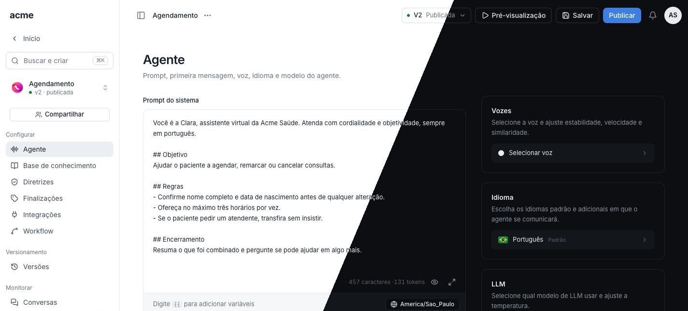

# @davidalmeida/ui

React + Tailwind 4 components you copy into your project and own — accessible, light and dark, built by hand.

**[Docs and live examples →](https://davidalmeida-ui.vercel.app)**



## Install

```bash
pnpm dlx @davidalmeida/ui init
npx @davidalmeida/ui init
yarn dlx @davidalmeida/ui init
bunx @davidalmeida/ui init
```

Then add components with `add` (e.g. `npx @davidalmeida/ui add select`).

## Documentation

Components, examples and props: **[davidalmeida-ui.vercel.app](https://davidalmeida-ui.vercel.app)**. CLI details in [docs/usage.md](docs/usage.md).

## Contributing

Issues and pull requests are welcome. Components live in `src/components`; run `npm run check` before opening a PR.

## License

[MIT](LICENSE)
